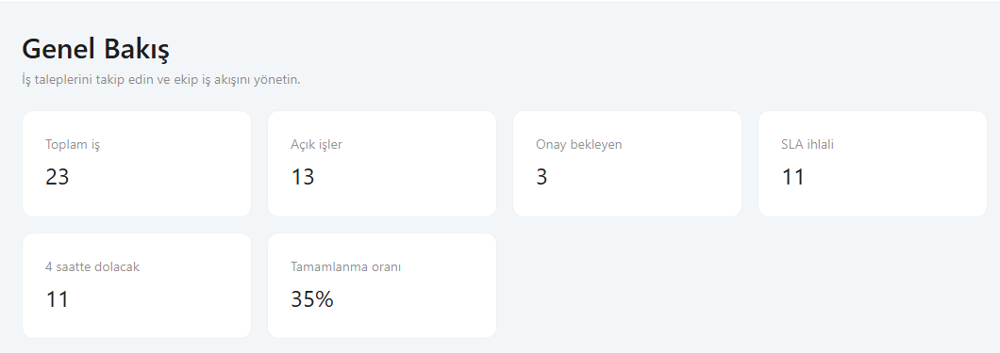
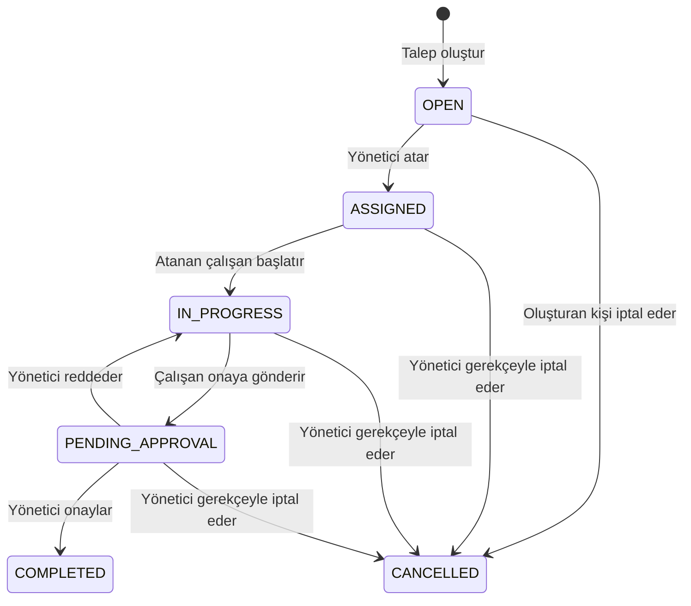

# FlowDesk

<p align="center">
  <strong>Kurumsal iş taleplerini tek bir akışta oluşturun, atayın, izleyin ve onaylayın.</strong>
</p>

<p align="center">
  
  
  
  
  
  
</p>

FlowDesk, kurum içi operasyon taleplerinin **oluşturulmasından tamamlanıp denetlenmesine kadar** olan yolculuğunu yöneten, gerçek PostgreSQL verisiyle çalışan bir full-stack iş akışı uygulamasıdır. Öncelik ve SLA takibi, rol tabanlı erişim, yönetici onayı ve işlem geçmişini sade bir kurumsal arayüzde bir araya getirir.

## Ürüne bakış



Dashboard; kuyruk, SLA ve tamamlanma metriklerini backend API'sinden alır. Menü ve kullanılabilir işlemler oturum açan kullanıcının rolüne göre gösterilir; erişim kontrolleri sunucu tarafında da uygulanır.

## Öne çıkan yetenekler

- **Durum kontrollü iş akışı:** Talep açılışından atamaya, çalışmaya, yönetici onayına ve tamamlanmaya kadar tanımlı geçişler.
- **Akıllı iş kuyruğu:** Öncelik, SLA tarihi, açılış zamanı ve kayıt kimliğine göre sıralama; durum, kategori, sorumlu, tarih, SLA ihlali ve metin filtreleri sunucu tarafında çalışır.
- **SLA görünürlüğü:** P1 için 4 saat, P2 için 24 saat, P3 için 72 saat takvim saati hedefleri; periyodik ihlal kontrolü ve dashboard göstergeleri.
- **Güvenilir yönetici işlemleri:** Atama ve öncelik değişiminde transaction; öncelik ve iptalde zorunlu gerekçe; eşzamanlı düzenlemelerde optimistic locking.
- **Denetlenebilirlik:** Kritik durum ve yönetim değişiklikleri için aktör, zaman, önceki/yeni değer ve gerekçe içeren audit kayıtları.
- **Kişisel bildirimler:** Atama, onay, ret, SLA ihlali ve öncelik değişiminde kullanıcıya özel uygulama içi bildirim.
- **Rol bazlı deneyim:** ADMIN, MANAGER, EMPLOYEE ve AUDITOR için farklı ekran ve işlemler.
- **Tek komutla demo:** PostgreSQL, backend ve Nginx ile sunulan frontend Docker Compose üzerinden ayağa kalkar.

## İş akışı



`COMPLETED` ve `CANCELLED` terminal durumlardır. Çalışan yalnızca kendisine atanmış işi başlatabilir; işi oluşturan yönetici kendi üzerindeki işi onaylayamaz. Geçersiz geçişler API tarafından reddedilir.

## Roller

| Rol | Erişim özeti |
|---|---|
| **ADMIN** | Kullanıcı/rol yönetimi, kategori yönetimi API'si, tüm talepler ve denetim kayıtları |
| **MANAGER** | Tüm iş kuyruğu, personele atama, öncelik yönetimi, onay/ret ve operasyon metrikleri |
| **EMPLOYEE** | Talep oluşturma, kendi veya atandığı işleri görme, başlatma ve onaya gönderme |
| **AUDITOR** | Talepleri, audit kayıtlarını ve raporları salt okunur inceleme |

Rol kontrolü yalnızca arayüzde değil, Spring Security ve servis kurallarında da yapılır. Oturum bilgisi `localStorage` içinde saklanmaz.

## Teknoloji yığını

| Katman | Teknolojiler |
|---|---|
| Backend | Java 21, Spring Boot 3.5, Spring MVC, Spring Security, Spring Data JPA, Bean Validation |
| Kalıcılık | PostgreSQL 16, Flyway migration |
| Frontend | React 18, TypeScript, Vite, Ant Design 5, React Router, TanStack Query, Axios |
| Test | JUnit 5, Mockito, Testcontainers, Vitest, React Testing Library, Playwright |
| Çalıştırma | Maven Wrapper, Docker, Docker Compose, Nginx |

## Hızlı başlangıç

Gereksinimler: Docker Desktop ve Compose eklentisi. Backend ve frontend derlemeleri container içinde yapılır; yerel makinede Java veya Node kurulumu gerekmez.

```bash
git clone https://github.com/utkmert/flowdesk.git
cd flowdesk
cp .env.example .env
docker compose up --build
```

Windows PowerShell'de ortam dosyasını oluşturmak için:

```powershell
Copy-Item .env.example .env
docker compose up --build
```

| Adres | İçerik |
|---|---|
| [http://localhost:3000](http://localhost:3000) | FlowDesk web arayüzü |
| [http://localhost:3000/swagger-ui/index.html](http://localhost:3000/swagger-ui/index.html) | OpenAPI / Swagger UI |

İlk açılışta Flyway veritabanı şemasını kurar. `APP_DEV_SEED=true` iken geliştirme profiline özel sentetik kullanıcılar, 8 kategori ve 50 örnek talep oluşturulur. Seed tekrarlanabilir biçimde çalışır. Uygulamayı durdurmak için `Ctrl+C`; arka planda çalıştırdıysanız `docker compose down` kullanın. Veritabanı volume'ünü korumak için `docker compose down -v` komutunu kullanmayın.

### Demo hesapları

Tüm demo parolaları: **`FlowDesk123!`**

| Rol | Kullanıcı adı |
|---|---|
| ADMIN | `admin` |
| MANAGER | `manager1`, `manager2` |
| EMPLOYEE | `employee1`, `employee2`, `employee3`, `employee4`, `employee5` |
| AUDITOR | `auditor` |

### Geliştirme sunucuları

Frontend için `pnpm dev`, backend için Java 21 ile `./mvnw spring-boot:run` kullanın. Vite `/api` çağrılarını `localhost:8080`'e proxy eder. Docker ortamında Nginx aynı-origin reverse proxy olarak çalışır.

## API ve veri modeli

REST API `/api/v1` altında sürümlenir. Başlıca kaynaklar:

- `/tickets` — arama, filtreleme, sayfalama, detay ve talep oluşturma
- `/tickets/{id}/assign` ve `/tickets/{id}/priority` — yönetici işlemleri
- `/tickets/{id}/actions/{START|SUBMIT|APPROVE|REJECT|CANCEL}` — durum geçişleri
- `/dashboard`, `/notifications`, `/audit`, `/admin/users`, `/categories`

## Proje yapısı

```text
flowdesk/
├── backend/                 # Spring Boot modüler monolit
├── frontend/                # React SPA ve Playwright testleri
├── docs/                    # Mimari, API, veritabanı, güvenlik ve eğitim dokümanları
│   └── images/dashboard.png # README ürün görseli
├── .github/workflows/       # CI iş akışı
├── docker-compose.yml
└── README.md
```


